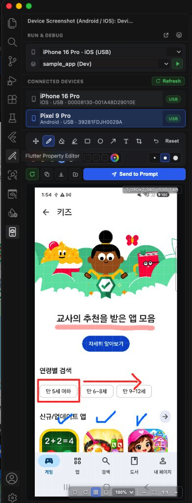

# Device Screenshot (Android & iOS)

Capture live screenshots from connected **Android & iOS physical devices** (as well as emulators and simulators) and control **Run & Debug (Target Device, Flavor, Offline Emulator Boot, Hot Reload)** directly inside a single compact **VS Code** & **Antigravity IDE** Left Sidebar — complete with built-in **Markup, Non-Destructive Eraser, Crop, Translucent HUD, and 1-Click Send to Active AI Prompt (Copilot Chat & Antigravity)**.

---

## Key Features (English)

### 1. Compact Run & Debug Control Card (New in v1.0.2)
- **All-in-One Single Sidebar Workflow**: Select your target device, pick a `.vscode/launch.json` flavor (`Dev`, `Staging`, `Prod`, etc.), and launch/debug without opening the Command Palette (`Select Device`) or switching away to the `Run and Debug` view (`suppressDebugView`).
- **Offline Emulator & Simulator Auto-Boot**: Lists connected physical devices at the top (`Available Devices`) followed by unbooted Android AVDs (including Cold Boot) and `Start iOS Simulator` (`Offline Emulators`) — selecting an offline emulator and pressing **Run (`▶`)** boots it automatically and launches your app.
- **Separated from Screenshot Selection**: Your Run & Debug target spinner stays independent from the `Connected Devices` screenshot list below, so capturing screenshots from multiple devices never interrupts your active debug target.
- **Live Session Controls**: Automatically displays **Hot Reload (`⚡`)**, **Hot Restart (`↻`)**, and **Stop (`■`)** right next to the flavor selector while debugging Flutter/Dart or mobile sessions.

### 2. Physical Device First & Real-Time Hotplug (Android & iOS)
- **Real-Time Hotplug Auto-Detection**: Automatically detects USB/wireless device connection and disconnection within 1~2 seconds without manual refresh, paired with a high-visibility emerald green **`[↻ Refresh]`** button.
- **Visual USB vs Wi-Fi Badges**: Displays color-coded badges distinguishing wired **`[USB]`**, wireless debugging **`[Wi-Fi]`**, and virtual **`[Simulator]`** / **`[Emulator]`**.
- **Android Physical Devices & Emulators**: Detects USB and wireless debugging devices via `adb` (`adb exec-out screencap -p`) and sorts physical devices to the top.
- **iPhone / iPad Physical Devices & Simulators**: Full support on macOS via Xcode `xcrun devicectl` (including idle paired CoreDevice USB tunnels verified via `ioreg`), `idevicescreenshot` (`libimobiledevice`), and `xcrun simctl`.

### 3. Always-Visible Action Bar & Smart AI Prompt Routing
- **Guaranteed Top Visibility**: The single-row action bar (**Recapture `R`**, **Copy `Cmd+C`**, **Save `Cmd+S`**, **Save As**, and **Send to Prompt**) sits **directly above the screenshot viewport**, ensuring controls are never covered by bottom IDE notification popups or clipped on compact window heights.
- **Smart Active Prompt Routing (`Send to Prompt`)**: Automatically detects which AI chat panel is currently expanded/active — natively attaching the screenshot into **GitHub Copilot Chat** or **Antigravity Prompt** without unfolding collapsed panels.
- **Expand to Editor Tab**: Click the **Expand** icon in the top header to inspect and annotate in a full-size editor tab.

### 4. Built-in macOS-Style Markup, Eraser, Crop & Translucent HUD
- **Drawing & Annotation Tools**:
  - **Pen & Highlighter**: Freehand drawing and semi-transparent highlighting.
  - **Non-Destructive Eraser**: Erases only drawn annotations while keeping the underlying device screenshot 100% intact.
  - **Shapes, Text & Area Crop**: Draw **Rectangles**, **Circles**, **Arrows**, type **Text**, or drag to **Crop** any region (`Undo Cmd+Z` up to 30 steps & 1-click `Reset`).
- **Custom Color Picker & Visual Stroke Sizes**: 5 preset circular swatches + 3 saved custom color slots (color picker & `#HEX` input) + 3 visual thickness indicators.
- **Translucent In-Screen Floating HUD**: Compact see-through bottom-right overlay inside the screenshot viewport for **Rotate Left/Right (`90°`)**, **Pixel Grid**, **Rounded Corners**, **Output Scale (`100%~25%`)**, and **Zoom (`-`, `Fit`, `1:1`, `+`)**, letting the underlying screenshot remain clearly visible behind the toolbar.

### 5. 12 Languages Supported
Full UI localization (selectable via the header **Settings (`⚙`)** button or IDE Settings `deviceScreenshot.language`, defaulting to English):
- English (`en`), 한국어 (`ko`), 日本語 (`ja`), 中文 (`zh`), हिन्दी (`hi`), Português (`pt`), Français (`fr`), Español (`es`), Bahasa Melayu (`ms`), Tiếng Việt (`vi`), ไทย (`th`), Deutsch (`de`).

### Requirements
- **Android**: Android SDK Platform-Tools (`adb`) installed (auto-detected from `PATH`, `~/Library/Android/sdk/platform-tools/adb`, or configurable in Settings).
- **iOS (macOS)**: Xcode Command Line Tools (`xcrun devicectl` / `xcrun simctl`) or `libimobiledevice` (`brew install libimobiledevice`).

---

## 주요 기능 및 안내 (한국어)

**Device Screenshot (Android & iOS)** 는 VS Code 및 Antigravity IDE의 **왼쪽 사이드바(Activity Bar)** 하나만으로 **기기 선택 및 Flavor 실행/디버그(Run & Debug)** 부터 **안드로이드/아이폰 실기기·에뮬레이터 화면 캡처, 마크업·크롭, 클립보드 복사, 활성 AI 프롬프트(Copilot Chat / Antigravity) 즉시 첨부**까지 모두 해결할 수 있는 올인원 확장 프로그램입니다.

### 1. 심플 통합 Run & Debug 컨트롤 바 (v1.0.2 신규)
- **사이드바 하나로 끝내는 기기 선택 & Flavor 실행**: 매번 커맨드 팔레트(`Select Device`)나 `Run and Debug` 탭을 오갈 필요 없이, 상단 스피너에서 타겟 기기와 `.vscode/launch.json`의 Flavor(`Dev`, `Staging`, `Prod` 등)를 골라 녹색 **`[▶]`** 버튼으로 즉시 실행할 수 있습니다 (실행 시 강제로 디버그 탭으로 화면이 넘어가지 않도록 자동 유지).
- **오프라인 에뮬레이터 & iOS 시뮬레이터 자동 구동**: 실제 연결된 기기(`Available Devices`)를 최상단에 우선 표시하며, 아직 켜지지 않은 Android 에뮬레이터(Cold Boot 포함)와 iOS 시뮬레이터(`Offline Emulators`)도 선택하여 실행 시 자동으로 부팅 후 앱을 실행합니다.
- **실행용 기기 vs 스크린샷 기기 분리**: 상단 실행 타겟 스피너와 하단 스크린샷용 `Connected Devices` 목록이 독립적으로 동작하여, 여러 기기의 스크린샷을 번갈아 찍어도 현재 디버그 타겟이 섞이지 않습니다.
- **실시간 디버그 제어**: 실행 중에는 **핫 리로드(`⚡`)**, **핫 리스타트(`↻`)**, **중지(`■`)** 아이콘이 우측에 자동으로 나타납니다.

### 2. 실기기 우선 감지 & 실시간 Hotplug (Android & iOS)
- **실시간 Hotplug 자동 감지 & 녹색 새로고침 버튼**: USB 연결/분리 시 1~2초 내에 목록이 자동 갱신되며, 시인성 높은 녹색 **`[↻ Refresh]`** 버튼으로 언제든 즉시 재검색할 수 있습니다.
- **USB 유선 vs Wi-Fi 무선 구분 뱃지**: 유선 **`[USB]`**, 무선 디버깅 **`[Wi-Fi]`**, 가상 기기 **`[Simulator]`** / **`[Emulator]`** 상태를 직관적인 컬러 뱃지로 구분합니다.
- **iPhone / Android 실기기 완벽 지원**: `adb` 및 macOS Xcode `xcrun devicectl`(대기 상태 페어링 터널 및 `ioreg` USB 하드웨어 교차 검증 포함), `idevicescreenshot`, `xcrun simctl`을 모두 지원합니다.

### 3. 가려지지 않는 상단 액션 바 & 스마트 AI 프롬프트 전송
- **항상 노출되는 1줄 액션 바**: **재캡처(`↻`, 단축키 `R`)**, **클립보드 복사(`Cmd+C`)**, **저장(`Cmd+S`)**, **다른 이름으로 저장**, **Send to Prompt** 버튼을 **스크린샷 뷰 바로 위**에 1줄로 배치하여, 창 높이가 작거나 IDE 하단에 시스템 로딩/알림 팝업이 떠도 버튼이 절대 가려지지 않습니다.
- **스마트 활성 프롬프트 자동 라우팅 (`Send to Prompt`)**: 현재 화면에 펼쳐져 있는 AI 채팅창(**GitHub Copilot Chat** 또는 **Antigravity 프롬프트**)을 자동 감지하여, 접혀 있는 다른 패널을 강제로 펼치지 않고 현재 사용 중인 프롬프트로 이미지를 바로 첨부합니다.

### 4. 내장 마크업 · 원본 보존 지우개 · 크롭 · 반투명 플로팅 HUD
- **직관적인 드로잉 & 원본 보존 지우개**: 펜슬, 형광펜, 사각형, 원, 화살표, 텍스트, 영역 자르기(Crop), 실행 취소(`Cmd+Z` 30단계) 및 원본 복구(`Reset`)를 지원하며, 지우개는 캡처 원본을 훼손하지 않고 그린 주석만 지워줍니다.
- **커스텀 컬러 & 굵기 선택**: 5가지 기본 컬러 + 최대 3개 자동 저장 커스텀 컬러(`#HEX` 지원) + 3단계 원형 굵기 선택기 제공.
- **반투명 인스크린 플로팅 편집/줌 바**: 스크린샷 우측 하단에 회전(`90°`), 픽셀 그리드, 둥근 모서리, 해상도 배율(`100%~25%`), 확대/축소(`-`, `Fit`, `1:1`, `+`) 버튼을 **반투명 플로팅 바**로 집약해 세로 공간을 아끼면서도 뒤쪽 스크린샷 화면이 그대로 비쳐 보입니다.
- **12개 국어 지원**: 상단 `⚙` 설정 버튼에서 영어(`en`), 한국어(`ko`), 일본어(`ja`), 중국어(`zh`) 등 12개 언어를 즉시 전환할 수 있습니다.

---

## Support & Sponsor

If this extension saves your mobile debugging & AI pair-programming time, consider buying me a coffee! ☕  
이 확장 프로그램이 개발 시간을 아껴주었다면 따뜻한 커피 한 잔으로 응원해 주세요! ☕

---

## License
MIT © [etoxiuq](https://github.com/etoxiuq)
