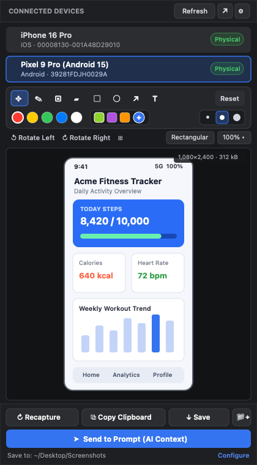
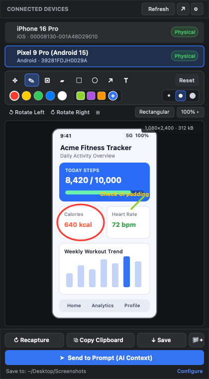

# Device Screenshot (Android & iOS)

Capture live screenshots from connected **Android & iOS physical devices** (as well as emulators and simulators) directly inside the **VS Code** & **Antigravity IDE** Left Sidebar — complete with built-in **Markup, Eraser, Crop, Rotation, Copy to Clipboard, and 1-Click Send to AI Prompt**.

---

## Key Features (English)

### 1. Physical Device First (Android & iOS)
- **Android Physical Devices & Emulators**: Automatically detects USB and wireless debugging devices via `adb` (`adb exec-out screencap -p`) and sorts physical devices to the top.
- **iPhone / iPad Physical Devices**: Supports real iOS devices on macOS via Xcode `xcrun devicectl` (iOS 17+) and `idevicescreenshot` (`libimobiledevice`).
- **iOS Simulators**: Supports booted Xcode iOS Simulators via `xcrun simctl`.
- **Clean Unselected Initial State**: Opens in a clean standby view without taking unwanted captures until you click the device you want to capture.

### 2. Built-in macOS-Style Markup, Eraser & Crop

- **Drawing & Annotation Tools**:
  - **Pen & Highlighter**: Freehand drawing and semi-transparent highlighting.
  - **Non-Destructive Eraser**: Positioned right next to the Pen tool with an expanded visual brush ring — erases only your drawn annotations (pen, highlighter, shapes, text) while keeping the underlying device screenshot 100% intact.
  - **Shapes & Text**: Draw **Rectangles**, **Circles**, **Arrows**, or type **Text** directly over the screenshot.
  - **Area Crop**: Drag to select any region and crop (`Apply Crop`) or cancel.
  - **Undo (`Cmd+Z`) & Reset**: Step back through up to 30 edits or restore the original unedited capture with one click.
- **Custom Color Picker & Visual Stroke Sizes**:
  - **5 Preset Circular Swatches** (`Red`, `Yellow`, `Green`, `Blue`, `White`) + **3 Custom Rounded-Square Color Slots** with an interactive color picker & HEX input.
  - **Visual Circle Thickness Selector**: Side-by-side visual circle indicators (`Thin`, `Medium`, `Thick`) that automatically expand into larger rings when the Eraser tool is selected.

### 3. Instant Workflow: Copy, Save & Send to AI Prompt
- **Send to Prompt**: Saves the annotated/cropped screenshot and attaches it directly to your AI chat/prompt input (or copies it to your clipboard ready for `Cmd+V`).
- **Recapture (`R`) / Copy Clipboard (`Cmd+C`) / Save (`Cmd+S`) / Save As**: Conveniently grouped right below the preview viewport.
- **Expand to Editor Tab**: Click the compact Expand icon in the top header whenever you want to inspect and annotate in a full-size editor tab.
- **Rotation & Scaling**: Rotate `90°` left/right, preview `Rounded` display corners, toggle the pixel grid, and scale output resolution (`100%`, `75%`, `50%`, `25%`).

### 4. 12 Languages Supported
Full UI localization (selectable via the header **Settings** button or IDE Settings `deviceScreenshot.language`, defaulting to English):
- English (`en`), 한국어 (`ko`), 日本語 (`ja`), 中文 (`zh`), हिन्दी (`hi`), Português (`pt`), Français (`fr`), Español (`es`), Bahasa Melayu (`ms`), Tiếng Việt (`vi`), ไทย (`th`), Deutsch (`de`).

### Requirements
- **Android**: Android SDK Platform-Tools (`adb`) installed (auto-detected from `PATH`, `~/Library/Android/sdk/platform-tools/adb`, or configurable in Settings).
- **iOS (macOS)**: Xcode Command Line Tools (`xcrun devicectl` / `xcrun simctl`) or `libimobiledevice` (`brew install libimobiledevice`).

---

## 주요 기능 및 안내 (한국어)

**Device Screenshot (Android & iOS)** 는 VS Code 및 Antigravity IDE의 **왼쪽 사이드바(Activity Bar)** 에서 현재 연결된 **안드로이드 실기기/에뮬레이터**와 **아이폰(iOS) 실기기/시뮬레이터**의 화면을 즉시 캡처하고, 마크업·크롭·클립보드 복사·AI 프롬프트 전송까지 한 번에 처리할 수 있는 확장 프로그램입니다.

### 1. 실기기 우선 감지 (Android & iOS Physical Devices)
- **Android 실기기 및 에뮬레이터**: USB 및 무선 디버깅으로 연결된 기기를 `adb`로 자동 감지하며, 실기기를 목록 최상단에 우선 배치합니다.
- **iPhone / iPad 실기기**: macOS Xcode의 `xcrun devicectl` (iOS 17+) 및 `libimobiledevice`(`idevicescreenshot`)를 통해 연결된 실기기를 즉시 캡처합니다.
- **깔끔한 초기 대기 화면**: 사이드바를 열었을 때 임의로 캡처하지 않고, 원하는 기기를 클릭했을 때 즉시 캡처가 수행됩니다.

### 2. 내장 마크업(그리기) · 지우개 · 크롭 · 커스텀 컬러

- **직관적인 드로잉 & 지우개 툴**:
  - **펜슬 & 형광펜**: 자유 곡선 그리기 및 반투명 형광펜 강조
  - **원본 보존 지우개(Eraser)**: 펜슬 바로 옆에 위치하며, **캡처된 원본 화면은 절대 지우지 않고** 그 위에 그린 펜슬, 도형, 화살표, 텍스트만 깔끔하게 지워줍니다.
  - **도형 & 텍스트**: 사각형, 원, 화살표, 텍스트 입력 지원
  - **영역 자르기(Crop)**: 원하는 영역만 드래그하여 크롭 적용 및 취소 가능
  - **실행 취소(`Cmd+Z`) & 원본 복구(Reset)**: 최대 30단계 실행 취소 및 1클릭 원본 복원
- **커스텀 컬러 피커 & 직관적인 굵기 선택기**:
  - **5가지 기본 원형 컬러** + **최대 3개까지 자동 저장되는 사각형 커스텀 컬러 슬롯**(컬러 피커 및 `#HEX` 직접 입력 지원)
  - 텍스트 대신 **실제 굵기 비율을 보여주는 3단계 원형 버튼** 제공 (지우개 선택 시 지우개 배율에 맞춰 원 크기가 자동으로 확대 표시됨)

### 3. 빠른 액션 바 & AI 프롬프트 바로 전송
- **프롬프트로 전달 (Send to Prompt)**: 마크업하거나 크롭한 이미지를 AI 프롬프트 입력창으로 즉시 전달(및 클립보드 자동 복사)합니다.
- **하단 통합 액션 바**: 캡처 화면 바로 아래에서 **Recapture (`R`)**, **Copy Clipboard (`Cmd+C`)**, **Save (`Cmd+S`)**, **Save As (폴더+ 아이콘 버튼)** 를 한 번에 조작할 수 있습니다.
- **큰 창으로 열기 (Expand)**: 상단 헤더의 설정 아이콘 옆 **Expand** 아이콘 버튼을 눌러 넓은 에디터 탭에서도 동일하게 작업할 수 있습니다.
- **12개 국어 완벽 지원**: 기본 영어(`en`)를 비롯하여 한국어(`ko`), 일본어(`ja`), 중국어(`zh`), 힌디어(`hi`), 포르투갈어(`pt`), 프랑스어(`fr`), 스페인어(`es`), 말레이시아어(`ms`), 베트남어(`vi`), 태국어(`th`), 독일어(`de`)를 상단 톱니바퀴(설정)에서 즉시 전환할 수 있습니다.

---

## License
MIT © [etoxiuq](https://github.com/etoxiuq)
